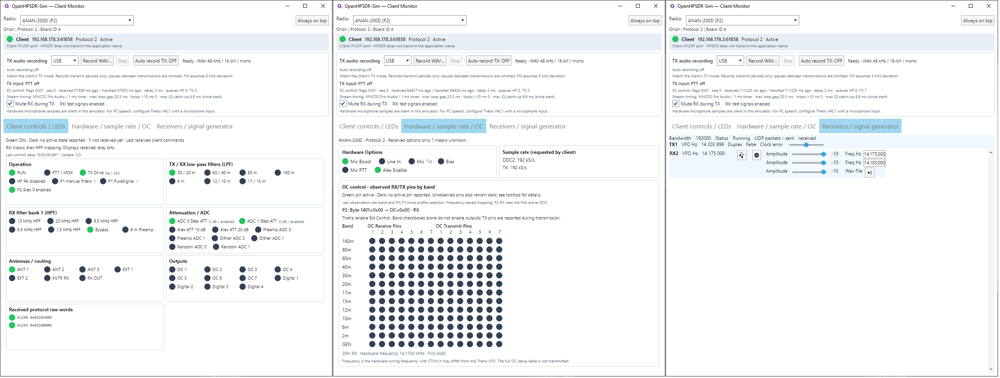

# OpenHPSDR-Sim

An OpenHPSDR radio emulator based on Patroclus (Alan Hopper, MIT).
It supports Protocol 1 and Protocol 2, generates synthetic IQ signals, and includes
a passive monitor for operating parameters sent by the client.
The user interface is in English. TX audio can be recorded as a WAV file: select
the mode (SSB/AM/FM), click **Record WAV…**, transmit, and then click **Stop**.
[Notes on recording](docs/tx-audio-recording.md).
The optional **Auto record TX** feature automatically creates a new WAV file for
each PTT transmission, labeled with the date, time, and selected operating mode.
This automatic recording is disabled by default upon startup.

## Starting

Run `Start-OpenHPSDR-Sim.cmd` to launch the current application located in the `run`
directory. The .NET 6 runtime is required. Please ensure only one instance of the
emulator is running at a time (due to UDP port 1024). An "Always on Top" option
is available in the top-right corner.

## Development

- `Patroclus.Avalonia/`: The active application; the project name and namespaces
are preserved to ensure compatibility with resources and XAML.
- `tests/`: Test programs for decoders, hardware profiles, P2 ports, and packet timing.
- `docs/`: Functional descriptions and test bench documentation.
- `run/`: The current executable Windows x64 version, including all required libraries.

Solution: `OpenHPSDR-Sim.sln`. Build the executable application:

```powershell
dotnet publish Patroclus.Avalonia/Patroclus.Avalonia.csproj -c Release -r win-x64 --self-contained false -p:DebugType=None -p:DebugSymbols=false -o ./run
```

Tests:

```powershell
dotnet run --project tests/ControlMonitor/ControlMonitor.csproj -c Release
dotnet run --project tests/Protocol2Ports/Protocol2Ports.csproj -c Release
dotnet run --project tests/RadioProfiles/RadioProfiles.csproj -c Release
dotnet run --project tests/PacketTiming/PacketTiming.csproj -c Release
dotnet run --project tests/TxAudio/TxAudio.csproj -c Release
dotnet run --project tests/RxTxSwitching/RxTxSwitching.csproj -c Release
```

[Functional description and limitations](docs/client-control-monitor.md) ·
[Test bench](docs/validation-client-monitor.md) · [MIT License](LICENSE.txt)

The OC band table contains observed states, not a complete copy of the
client configuration.


